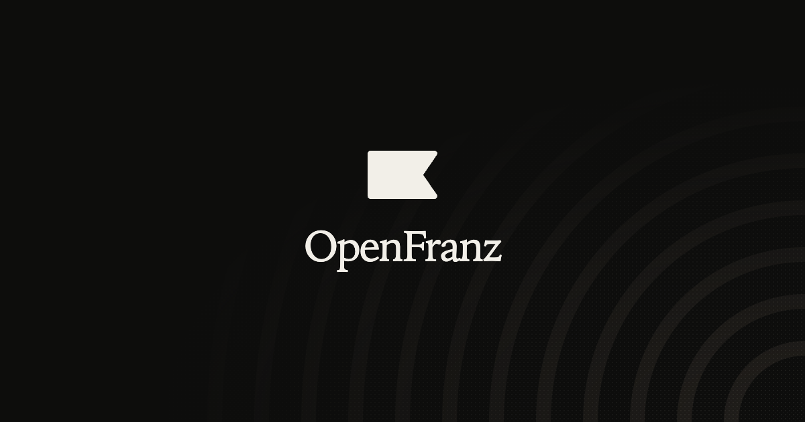

<p align="center">
  
</p>

<h1 align="center">OpenFranz</h1>

<p align="center">
  <strong>A script-writing agent that grows with your library and writes what's next.</strong>
</p>

<p align="center">
  
  
  
  
</p>

OpenFranz is a personal creative workspace for scriptwriting. Feed it public Instagram posts and Reels, pasted notes, brand facts, and the material you already trust. It turns that into a growing library of hooks, structures, phrases, and principles. When you ask for a script, a hook, or a caption, it writes from that library instead of inventing from thin air.

## Why it exists

Most writing tools hand you a blank page and a generic model. OpenFranz keeps the material that actually matters: the lines that worked, the structures you can reuse, and the brand facts that have to stay correct. The library grows every time you feed it something new.

## What it does

- Builds a shared creative library from public Instagram posts and Reels, pasted text, URLs, and brand facts
- Splits the library into two roots: `arsenal` for reusable writing material and `knowledge` for ideas that improve judgment
- Writes three variants for every creative request: hooks, scripts, CTAs, captions, or rewrites
- Grounds every answer in stored brand facts and library sources
- Links related material into a knowledge graph with fuzzy search, backlinks, related files, and shortest link paths
- Runs one shared workspace, so every file, brand, and chat lives in the same place

## How it works

1. **Feed it.** Paste text, a public URL, or a public Instagram post or Reel from the Ingest view.
2. **Let it learn the craft.** OpenFranz extracts the hooks, structures, phrases, and principles that made the source work.
3. **Write from the library.** Ask for a script, hook, CTA, or caption and get three variants, each with a different angle, drawn from the material it has already learned.

## Workspace

- **Chat** - talk to the agent, attach images, attach a brand, stop mid-turn
- **Files** - browse, search, and preview the shared library
- **Brands** - keep product facts, audience, tone, features, and pricing
- **Ingest** - save text, URLs, and public Instagram posts into the library

## Built with

- Nuxt 4 and Vue 3
- Eve agent runtime
- Better Auth with Google sign-in
- Drizzle ORM and Neon PostgreSQL
- @paper-design/shaders for the dithered landing and empty-state backgrounds
- force-graph for the knowledge graph

## Current scope

- Public Instagram posts and Reels only
- Private posts, profiles, and stories are rejected
- One shared workspace with no per-user isolation
- The full learning loop is still being built

## Technical overview

### Requirements

- Node.js 22.21+, 24.11+, or 26+
- pnpm
- A Neon PostgreSQL database
- A Google OAuth web client

### Setup

```bash
pnpm install
cp .env.example .env
```

Fill in `.env` locally. Never commit it.

Required variables:

```dotenv
DATABASE_URL=
GOOGLE_CLIENT_ID=
GOOGLE_CLIENT_SECRET=
BETTER_AUTH_SECRET=
BETTER_AUTH_URL=http://localhost:3000
OLLAMA_API_KEY=
OLLAMA_BASE_URL=https://ollama.com
```

Add this authorized redirect URI to the Google OAuth client:

```text
http://localhost:3000/api/auth/callback/google
```

### Database

Generate migrations after changing the schema:

```bash
pnpm db:generate
```

Apply migrations to the configured Neon database:

```bash
pnpm db:migrate
```

Check connectivity:

```bash
pnpm db:check
```

### Development

```bash
pnpm dev
```

Routes:

- `/` - landing page with Google sign-in
- `/app` - authenticated workspace

### Verification

```bash
pnpm test
pnpm exec nuxt typecheck
pnpm build
```
